<div align="center">
  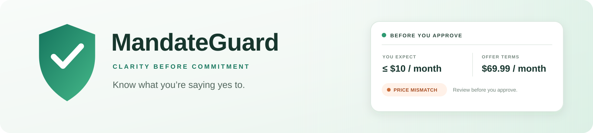

  <p><strong>Catch subscription surprises before you say yes.</strong><br />Turn billing language into clear terms, compare those terms with what you expected, and surface the differences before approval.</p>

  <p>
    <a href="https://mandateguard-tbjq.onrender.com/"><strong>Open the live app</strong></a>
    &nbsp; · &nbsp;
    <a href="assets/MandateGuard-demo.mp4"><strong>Watch the demo video</strong></a>
    &nbsp; · &nbsp;
    <a href="#screenshots"><strong>Explore screenshots</strong></a>
    &nbsp; · &nbsp;
    <a href="docs/mandateguard-devpost-thumbnail.png"><strong>Project thumbnail</strong></a>
  </p>

  <p>
    
    
    
    
    
  </p>
</div>

> **Demo safety:** PayPal examples use Sandbox or synthetic data. The UPI page is a simulation, not connected to NPCI, a bank, or a UPI app. The sample demo never creates a payment or mandate.

## The idea

Subscription offers often make the first payment easy to notice and the long-term commitment easy to miss. MandateGuard turns the offer into a plain-language summary, compares it with the shopper’s expectations, and highlights mismatches such as a higher recurring price, a fixed term, or a cancellation promise that conflicts with the billing schedule.

The AI helps read text. **Deterministic TypeScript rules make the comparison and severity decision.** Every finding points back to a checked term or an exact merchant quote.

## See it in action

<div align="center">
  <a href="assets/MandateGuard-demo.mp4">
    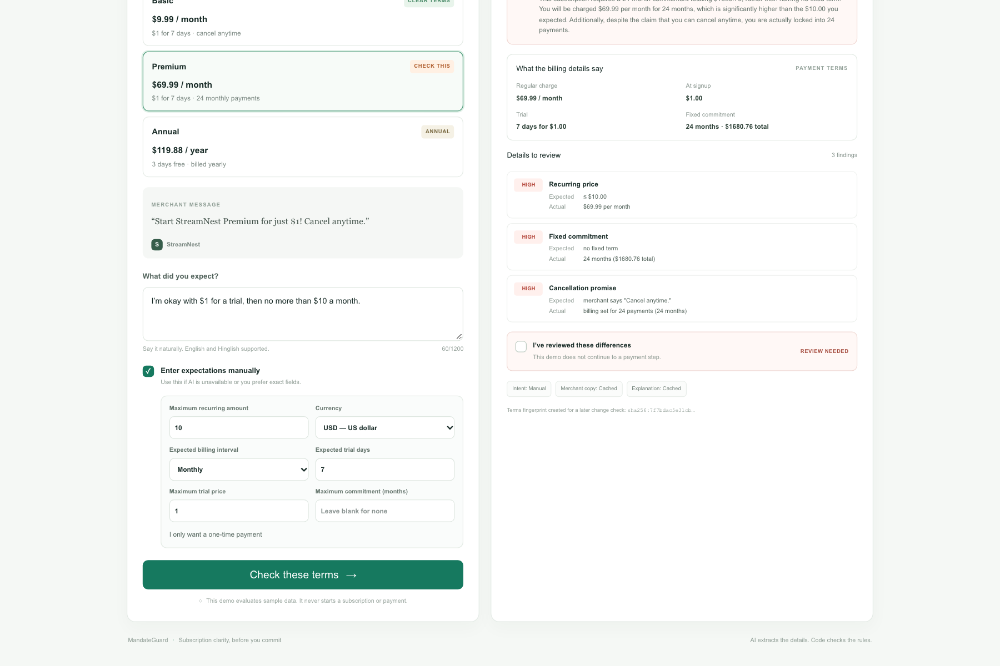
  </a>
  <p><sub>Click the preview to open the committed MP4 demo · 7.9 MB</sub></p>
</div>

## How a check works

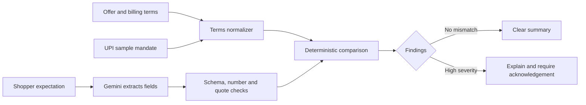

## Product tour

| Experience | What it does |
|---|---|
| **Store · `/`** | Choose a sample subscription, state what you expect, and review a checkpoint before continuing. |
| **Consumer demo · `/demo`** | Run the Part B terms engine against sample plans. Try the Basic plan for a match or Premium to see price, commitment, and cancellation findings. |
| **UPI simulator · `/upi-sim`** | Compare a sample mandate’s maximum debit cap and schedule with an expectation. All examples are simulated. |
| **Audit · `/audit`** | Review checkpoint decisions, PayPal status, and event timelines. |

The merged `main` branch includes `/demo`. If it is missing from the live Render site, run the app locally or ask the Render service owner to deploy the latest `main` branch.

## Screenshots

### Store and subscription review

<table>
  <tr>
    <td width="50%"><a href="docs/screenshots/01_store_plans.png">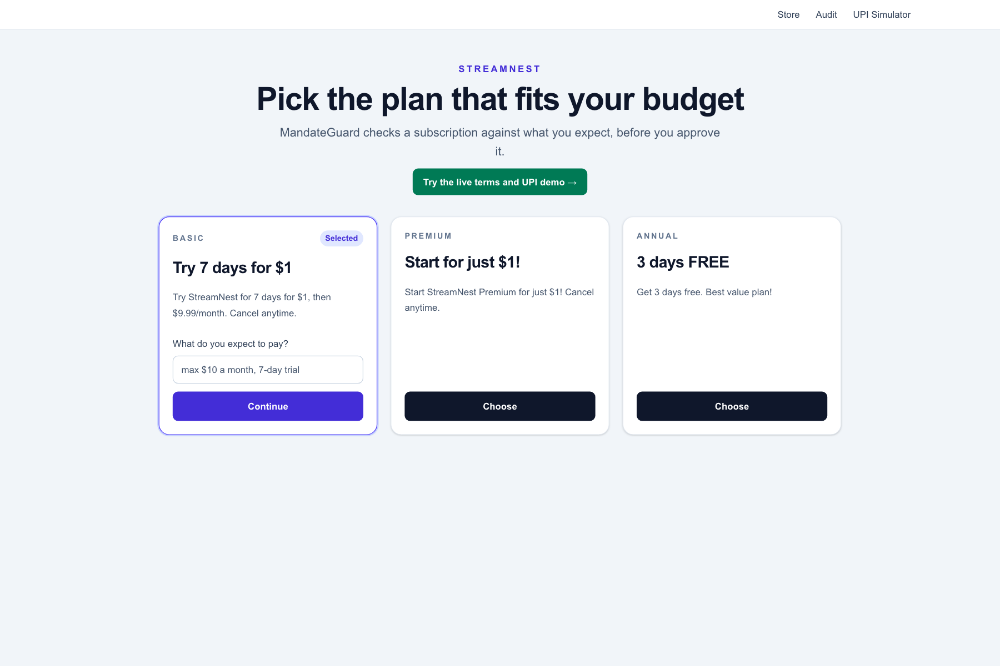</a><br /><strong>01 · Choose a plan</strong><br /><sub>Set expectations before starting a sample subscription check.</sub></td>
    <td width="50%"><a href="docs/screenshots/02_basic_plan_terms_match.png">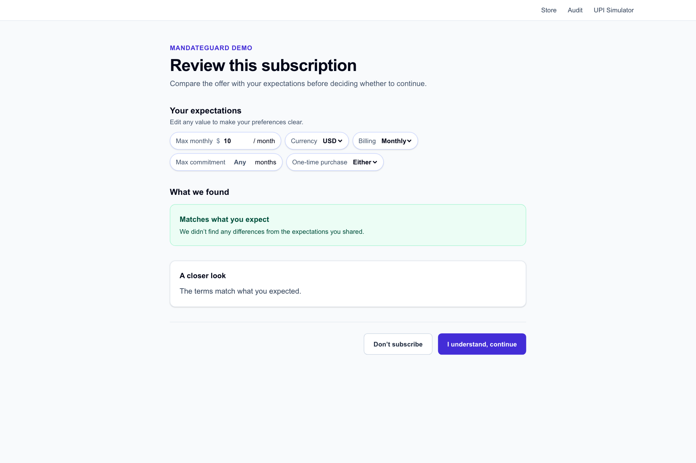</a><br /><strong>02 · A plan that matches</strong><br /><sub>Compare the recurring price and trial against the shopper’s limit.</sub></td>
  </tr>
  <tr>
    <td width="50%"><a href="docs/screenshots/03_premium_enter_expectation.png">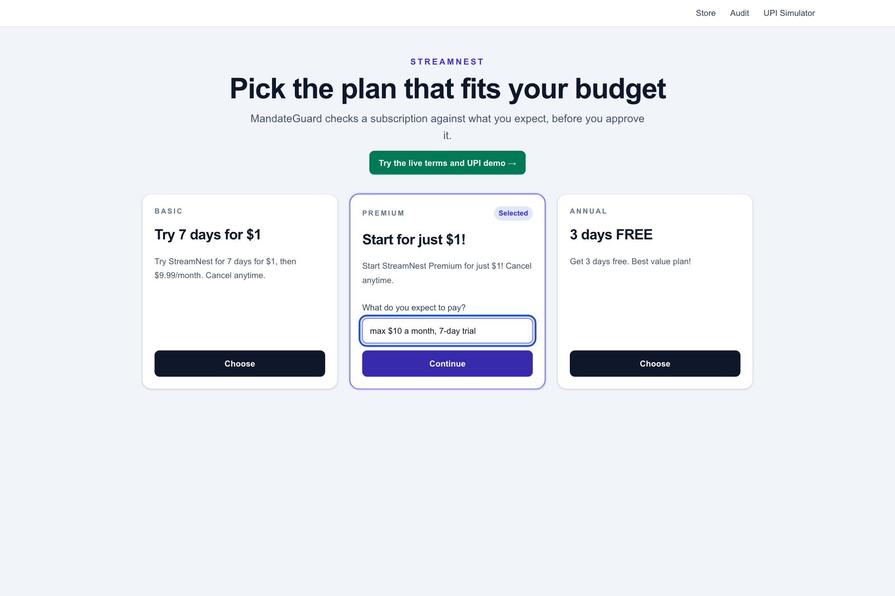</a><br /><strong>03 · Say what you expect</strong><br /><sub>Use natural language or enter exact values manually.</sub></td>
    <td width="50%"><a href="docs/screenshots/04_premium_high_findings.png">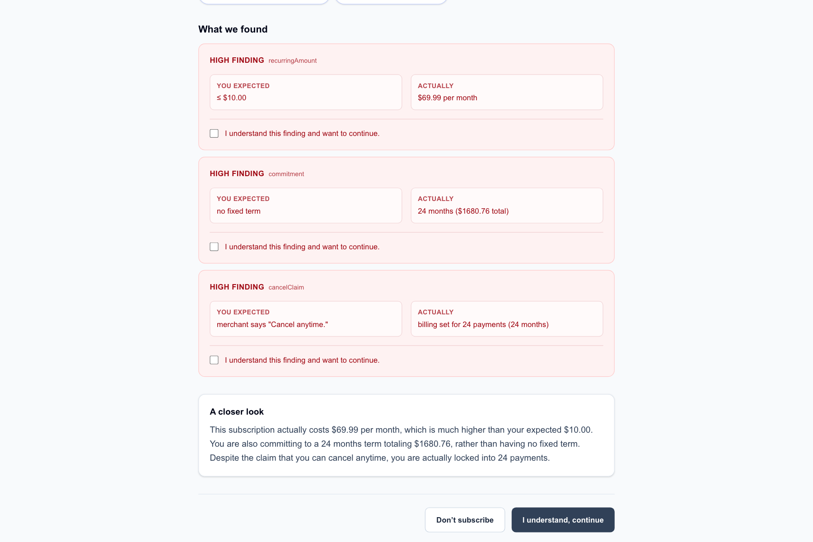</a><br /><strong>04 · Review high-severity findings</strong><br /><sub>See the actual $69.99 monthly charge and 24-month commitment.</sub></td>
  </tr>
  <tr>
    <td width="50%"><a href="docs/screenshots/05_premium_plain_language_explanation.png">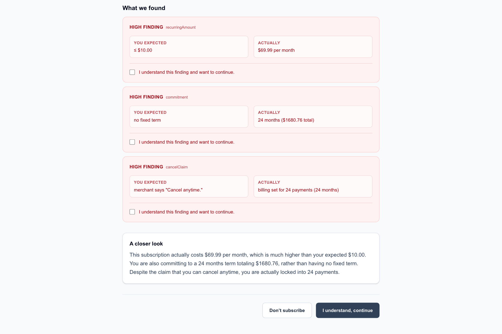</a><br /><strong>05 · Understand the mismatch</strong><br /><sub>A concise explanation connects the billing facts to the merchant’s wording.</sub></td>
    <td width="50%"><a href="docs/screenshots/06_consumer_demo_home.png">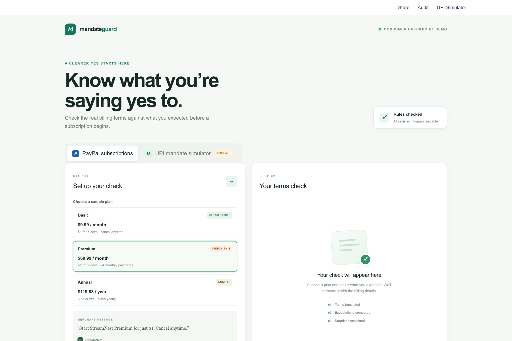</a><br /><strong>06 · Part B consumer demo</strong><br /><sub>Choose PayPal sample plans or switch to the UPI simulator.</sub></td>
  </tr>
</table>

### Part B demo and UPI simulation

<table>
  <tr>
    <td width="50%"><a href="docs/screenshots/07_consumer_demo_expectations.png">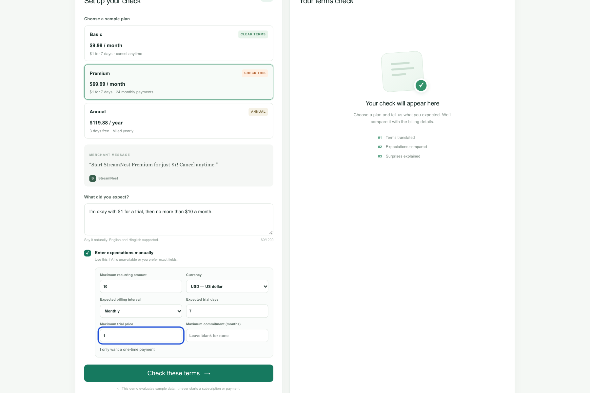</a><br /><strong>07 · Natural language and manual fallback</strong><br /><sub>Keep the check usable when AI is unavailable or exact fields are preferred.</sub></td>
    <td width="50%"><a href="docs/screenshots/08_consumer_demo_mismatch.png">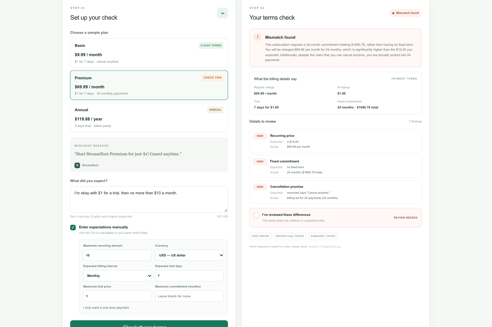</a><br /><strong>08 · Compare the offer</strong><br /><sub>See the sample billing facts beside the expectation.</sub></td>
  </tr>
  <tr>
    <td width="50%"><a href="docs/screenshots/09_consumer_demo_findings.png"></a><br /><strong>09 · Findings tied to evidence</strong><br /><sub>Price, term, and cancellation differences are checked separately.</sub></td>
    <td width="50%"><a href="docs/screenshots/10_upi_mandate_simulator.png">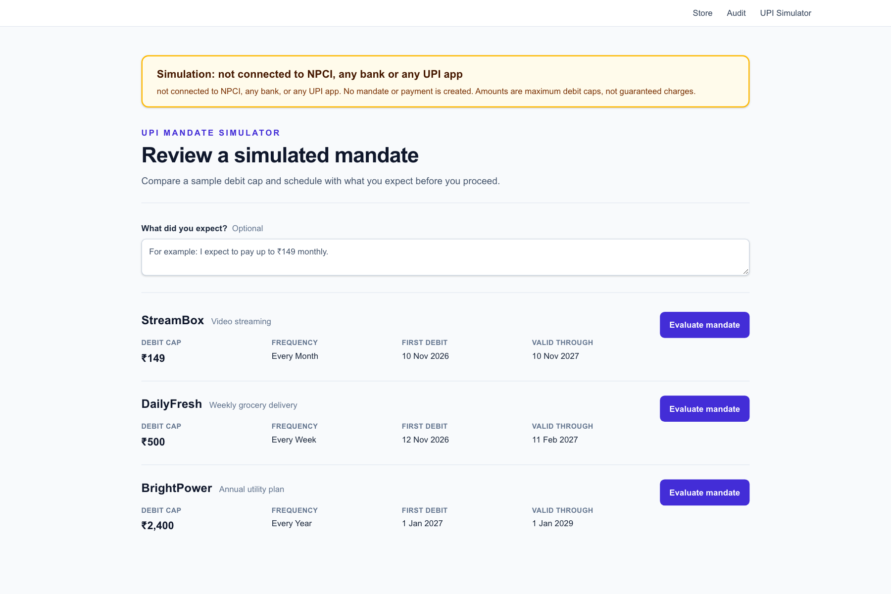</a><br /><strong>10 · Simulated UPI mandates</strong><br /><sub>Review maximum debit caps, frequency, and validity dates.</sub></td>
  </tr>
  <tr>
    <td width="50%"><a href="docs/screenshots/11_upi_mandate_evaluation.png">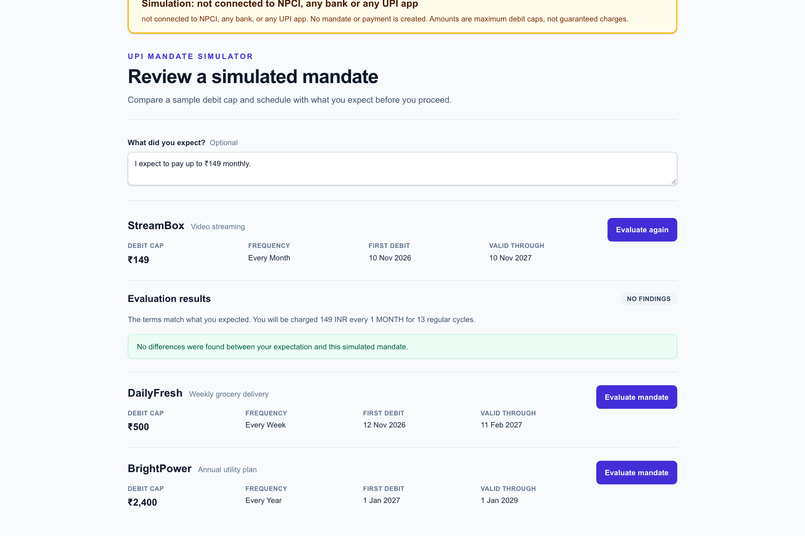</a><br /><strong>11 · UPI comparison result</strong><br /><sub>A matching expectation produces a clear result with no findings.</sub></td>
    <td width="50%"><a href="docs/screenshots/12_audit_log.png">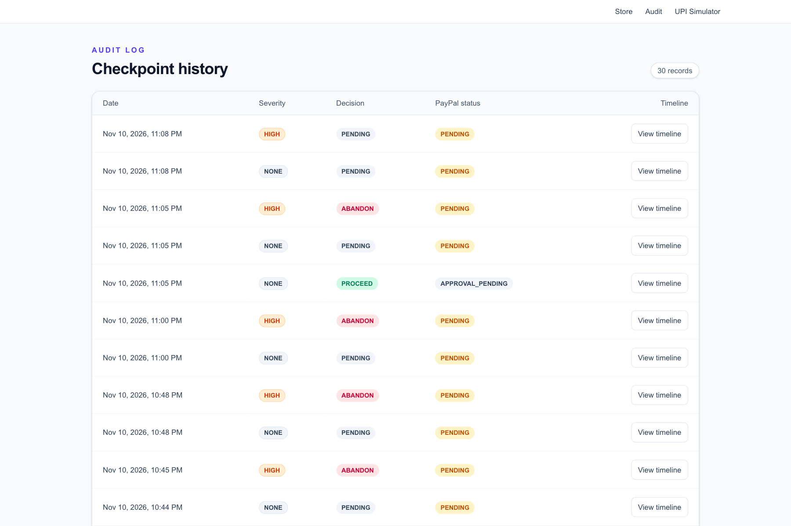</a><br /><strong>12 · Audit log</strong><br /><sub>Trace decisions and payment status across checkpoints.</sub></td>
  </tr>
  <tr>
    <td width="50%"><a href="docs/screenshots/13_audit_timeline.png">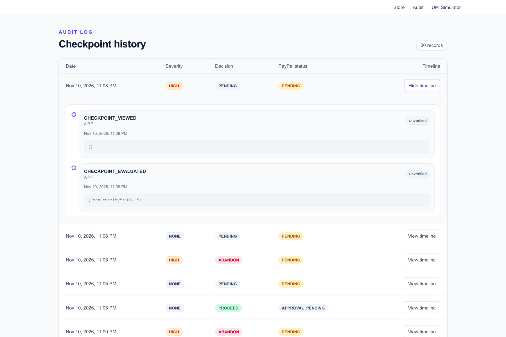</a><br /><strong>13 · Event timeline</strong><br /><sub>Inspect the recorded events behind a checkpoint’s status.</sub></td>
    <td width="50%"></td>
  </tr>
</table>

## Run locally

**Requirements:** Node.js 20.9 or later.

```bash
git clone https://github.com/shreyav2107/MandateGuard-paypal-hackathon.git
cd MandateGuard-paypal-hackathon
npm ci
cp .env.example .env.local
npm run dev
```

Open [http://localhost:3000](http://localhost:3000). On PowerShell, copy the environment template with `Copy-Item .env.example .env.local`. Keep `.env.local` private and out of Git.

The `/demo` and `/upi-sim` sample flows work without PayPal or database credentials. To use live Gemini extraction, add `GEMINI_API_KEY` and set `AI_MODE=live`. If AI is off, invalid, or rate-limited, use the manual expectations form; deterministic comparison and a fixed explanation template remain available.

## App and API

| Route | Purpose |
|---|---|
| `/` | PayPal Sandbox store and checkpoint flow. |
| `/demo` | Fixture-backed Part B consumer demo. |
| `/upi-sim` | Standalone UPI mandate simulator using sample data. |
| `/audit` | Checkpoint audit records and event timelines. |
| `POST /api/demo-checkpoints` | Evaluate a sample plan using server-owned fixture billing terms. |
| `GET` / `POST /api/upi-sim/evaluate` | List and evaluate simulated UPI mandates. Amounts are maximum debit caps, not promised charges. |
| `POST /api/checkpoints` | Create a checkpoint from a configured PayPal Sandbox plan and store it in Neon. |
| `/api/checkpoints/[id]` | Read a checkpoint. |
| `/api/checkpoints/[id]/decision` | Record the shopper’s decision. |
| `/api/checkpoints/[id]/verify` | Re-check the subscription terms. |
| `/api/webhooks/paypal` | Receive PayPal Sandbox webhook events. |

## How the checks work

1. PayPal billing-cycle data is normalized into trial length, recurring price, interval, commitment, setup fee, and taxes.
2. Gemini can extract shopper expectations and merchant claims. The server validates the response schema, checks inferred numbers against the source text, and requires exact quotes for claims.
3. The deterministic comparison engine compares actual terms with expectations and supported claims, then assigns severity.
4. High-severity findings require acknowledgement. Gemini may explain the checked facts; a fixed template is used when AI output is unavailable or invalid.

Gemini does not decide whether terms match or whether to warn. Those decisions live in `lib/compare.ts`.

## Configuration

Set these in `.env.local` for local development and in the Render service environment for deployment.

| Variable | Purpose |
|---|---|
| `PAYPAL_CLIENT_ID` | Client ID for the PayPal Sandbox REST app. |
| `PAYPAL_CLIENT_SECRET` | Server-side secret; never expose it to the browser. |
| `PAYPAL_BASE` | PayPal API base URL. Use Sandbox while developing. |
| `PAYPAL_WEBHOOK_ID` | ID of the webhook registered for the deployed service. |
| `PLAN_HONEST` | PayPal plan ID for the honest example. |
| `PLAN_TRAP` | PayPal plan ID for the trap example. |
| `PLAN_BORDERLINE` | PayPal plan ID for the borderline example. |
| `GEMINI_API_KEY` | API key for intent, merchant-claim, and explanation generation. |
| `GEMINI_MODEL` | Primary Gemini model name. |
| `GEMINI_FALLBACK_MODEL` | Fallback Gemini model name. |
| `AI_MODE` | Set to `mock` to disable AI calls or `live` to use Gemini. |
| `DATABASE_URL` | Neon Postgres connection string, including SSL parameters. |

### PayPal Sandbox and database setup

1. Create PayPal Sandbox Business and Personal test accounts in the [PayPal Developer Dashboard](https://developer.paypal.com/dashboard/).
2. Create a Sandbox REST app for the Business account. Set its client ID and secret in the environment, and keep `PAYPAL_BASE` on the Sandbox API.
3. Create the example plans with `npx tsx --env-file=.env.local scripts/seed-paypal.ts`; copy the printed IDs into the matching `PLAN_*` variables.
4. Create a Postgres project in [Neon](https://neon.tech/) and set its connection string as `DATABASE_URL`.
5. Create tables with `npm run db:migrate` and check the connection with `npm run db:check`.

## Useful commands

| Command | Purpose |
|---|---|
| `npm run dev` | Start the Next.js development server. |
| `npm run build` | Create the production build. |
| `npm start` | Serve the production build. |
| `npm run lint` | Run ESLint. |
| `npm test` | Run the Vitest suite. |
| `npm run db:migrate` | Create database tables from `db/schema.sql`. |
| `npm run db:check` | Check the Neon connection. |
| `npm run ai:check` | Check Gemini connectivity. |
| `npm run ai:eval` | Score 20 English and Hinglish intent examples. Target: at least 18 exact field matches. |
| `npm run ai:demo` | Run the AI demonstration script. |
| `npm run fixtures` | Create Sandbox subscriptions and save sanitized responses under `tests/fixtures/`. |

PayPal seed and fixture commands make Sandbox API calls. Run them manually after configuring Sandbox credentials.

## Deploy and webhooks

Deploy with `render.yaml`, then configure the environment variables in the Render service. Register a Sandbox webhook at `https://YOUR-SERVICE.onrender.com/api/webhooks/paypal`, subscribe to `BILLING.SUBSCRIPTION.*` and `PAYMENT.SALE.*`, and set its ID as `PAYPAL_WEBHOOK_ID`.

See the [Part B walkthrough script](docs/part-b-demo-script.md) for a short presentation flow.

License: [MIT](LICENSE).
